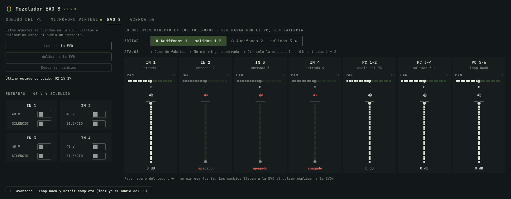

<p align="center"></p>

<h1 align="center">evo8-linux</h1>

<p align="center">
<a href="https://pypi.org/project/evo8-linux/"></a>
<a href="https://github.com/wh01s17/evo8-linux/actions/workflows/ci.yml"></a>

</p>

Control del **Audient EVO 8** en Linux: una ventana tipo consola y un CLI.

En Linux la EVO 8 funciona como interfaz de audio estándar, pero el kernel no
expone su mezcla de monitoreo interna, el ruteo del loop-back ni el phantom.
evo8-linux los controla hablando con la interfaz directamente por USB. Además
trae un mezclador para el sonido del PC y, si lo necesitas, un micrófono
virtual que junta tus entradas con el audio de otras apps. Cada una de esas
tres partes tiene su pestaña en la ventana.


## Índice

- [Qué hace](#qué-hace)
  - [El sonido del PC](#el-sonido-del-pc)
  - [El micrófono virtual (opcional)](#el-micrófono-virtual-opcional)
  - [El hardware de la EVO 8](#el-hardware-de-la-evo-8)
- [Instalación](#instalación)
  - [Arch Linux](#arch-linux)
  - [Otras distribuciones (pipx)](#otras-distribuciones-pipx)
  - [Desde el código](#desde-el-código)
  - [Primeros pasos](#primeros-pasos)
  - [Al actualizar o desinstalar](#al-actualizar-o-desinstalar)
- [Uso](#uso)
  - [La ventana](#la-ventana)
  - [La línea de comandos](#la-línea-de-comandos)
  - [Si el audio se corta](#si-el-audio-se-corta)
- [Cómo funciona](#cómo-funciona)
- [El repositorio](#el-repositorio)
- [Advertencia](#advertencia)
- [Licencia](#licencia)

## Qué hace

### El sonido del PC

Pestaña **SONIDO DEL PC**. Un mezclador para el audio del sistema, con una
tira por canal. Funciona igual con el micrófono virtual encendido o apagado.

- **Entradas de la EVO**: preamp en dB, volumen en el sistema, medidor y
  monitor (escuchar la entrada por la salida seleccionada, con latencia baja).
  El volumen vale para todo lo que graba de la EVO: el micrófono virtual, el
  monitor y cualquier app.
- **Apps**: volumen, silencio y si suenan por la salida o por Compartido.
- **Salida seleccionada**: volumen por par de canales y silencio.
- **Perfiles de tarjeta**: cómo usa el sistema cada tarjeta de sonido, con lo
  que hace cada opción.
- Los navegadores no pueden cambiar por su cuenta el volumen de los
  micrófonos (el control automático de ganancia de las videollamadas lo
  hacía).

### El micrófono virtual (opcional)

Pestaña **MICRÓFONO VIRTUAL**. Un micrófono más, **Mezcla**, que cualquier
app puede usar: OBS, un DAW, Discord o el navegador. Se **enciende y se
apaga** con el interruptor de arriba de la pestaña. Apagado no existe: no
aparece en las apps y el resto del sonido no cambia.

- **Qué suma**: las entradas de la EVO que elijas y **Compartido**, una
  salida virtual. Lo que mandes a Compartido (música, un metrónomo, un
  backing track) lo escuchas tú y además entra en la Mezcla.
- **Entradas a elección**: empieza con la 1 y la 2. **+** agrega la 3 o la
  4 y ✕ quita cualquiera, al instante y sin cortes, aunque una app esté
  usando el micrófono.
- **Ganancia en vivo** de cada entrada y de Compartido, cuánto oyes
  Compartido, y qué apps suenan por Compartido, con un interruptor por app.
- **Sincronía**: quien toca sobre la música la oye con retraso, y su
  instrumento llega con otro. *Calibrar* mide ese desfase mientras tocas
  sobre un click y lo compensa retrasando la música solo hacia la Mezcla.
- **Monitor de la Mezcla**: escuchar el micrófono tal como lo reciben las
  apps.


### El hardware de la EVO 8

Pestaña **EVO 8**. Ajustes que viven en la interfaz y van por USB. Cada envío
corta el audio un instante, así que los cambios quedan en espera hasta que
pulsas *Aplicar a la EVO*.

- **Mezcla de monitoreo interna**: lo que oyes directo en los audífonos, sin
  pasar por el PC y sin latencia. Es la matriz de 10 entradas (4 analógicas y
  6 del PC) × 4 salidas, con fader, paneo y silencio, y atajos como «Como de
  fábrica» u «Oír entradas 1 y 2».
- **Loop-back**: qué llega a los canales de captura 5-6. Puede ser el par de
  fábrica, todo lo que suena en el PC (salidas 1-2), las salidas 3-4 o las
  entradas 1-2 / 3-4.
- **Entradas**: phantom 48 V y silencio. (El preamp está en SONIDO DEL PC:
  se cambia sin cortes.)
- **Al conectarla**: la EVO olvida sus ajustes cuando se apaga. Un servicio
  restaura los preamps, la mezcla interna y el loop-back al conectarla. El
  phantom nunca se enciende solo.



## Instalación

Solo para la **Audient EVO 8** (no la EVO 4 ni la EVO 16). El control por USB
se probó con el firmware 1.4c.

Hay tres formas de instalarla. Elige una sola: si mezclas dos, los comandos
de una tapan a los de la otra. `evoctl --version` dice qué versión tienes.

### Arch Linux

**Instalar**

```sh
git clone https://github.com/wh01s17/evo8-linux
cd evo8-linux/packaging/arch
makepkg -si
```

Instala todo en el sistema y trae las dependencias, incluida la fuente de los
íconos. Después, desconecta y vuelve a conectar la EVO una vez.

**Actualizar**

```sh
cd evo8-linux/packaging/arch
git pull
makepkg -si
```

El paquete se compila siempre desde lo último de GitHub. `git pull` trae el
PKGBUILD al día, por si cambió.

**Desinstalar**

```sh
evoctl mezcla off
sudo pacman -Rns evo8-linux-git
```

`evoctl mezcla off` va antes: desactiva el micrófono virtual en tu usuario.

### Otras distribuciones (pipx)

**Instalar**

```sh
pipx install "evo8-linux[gui,usb]"
evoctl setup
```

pip solo instala Python. `evoctl setup` copia a tu usuario lo demás: la
config y el servicio del micrófono virtual, el servicio que restaura los
ajustes al conectar la EVO y la entrada del menú. Para la regla udev (control
por USB sin root) te da el comando `sudo` exacto. También avisa si falta algo
del sistema (PipeWire, WirePlumber, `pactl`, `amixer` o la fuente
*JetBrainsMono Nerd Font*) y si el portal de escritorio quedó con 0 µs de
tiempo real (ver [Si el audio se corta](#si-el-audio-se-corta)).

**Actualizar**

```sh
pipx upgrade evo8-linux
evoctl setup
```

`evoctl setup` va después de cada actualización: deja al día los archivos que
copió a tu usuario.

**Desinstalar**

```sh
evoctl setup --remove
pipx uninstall evo8-linux
sudo rm /etc/udev/rules.d/70-audient-evo8.rules
```

`evoctl setup --remove` apaga el micrófono virtual y quita los archivos de tu
usuario. La regla udev la pusiste con `sudo`, así que se quita igual.

### Desde el código

Requisitos: PipeWire + WirePlumber, `pactl`, `amixer`, Python ≥ 3.11,
`python-pyusb`, `pyside6`, `qt6-svg` y *JetBrainsMono Nerd Font*
(`ttf-jetbrains-mono-nerd`).

**Instalar**

```sh
git clone https://github.com/wh01s17/evo8-linux
cd evo8-linux
make install      # evoctl y evo8-mixer en ~/.local/bin, apuntando a esta carpeta
sudo make udev    # control por USB sin root
```

**Actualizar**

```sh
cd evo8-linux
git pull
make install
```

Los comandos y la config de PipeWire apuntan a la carpeta, así que `git pull`
basta para ellos. `make install` actualiza las copias: los servicios y la
entrada del menú.

**Desinstalar**

```sh
cd evo8-linux
make uninstall
sudo rm /etc/udev/rules.d/70-audient-evo8.rules
```

### Primeros pasos

1. Pon la EVO 8 en el perfil **Pro Audio**, desde la pestaña SONIDO DEL PC
   (columna PERFILES) o con
   `evoctl profiles set alsa_card.usb-Audient_EVO8-00 pro-audio`.
2. Si quieres el micrófono virtual, enciéndelo con el interruptor de la
   pestaña MICRÓFONO VIRTUAL o con `evoctl mezcla on`. Viene apagado.
3. En la app, elige **Mezcla** como micrófono. Si la app tiene supresión de
   ruido o control automático de ganancia, desactívalos: alteran la música
   que mandas por Compartido.

### Al actualizar o desinstalar

- Reabre la ventana para usar la versión nueva.
- Si la actualización cambió el micrófono virtual y lo usas, apágalo y
  enciéndelo para cargarlo: `evoctl mezcla off && evoctl mezcla on`. No corta
  el resto del audio. El [CHANGELOG](https://github.com/wh01s17/evo8-linux/blob/main/CHANGELOG.md)
  avisa cuando hace falta.
- **Desde la versión 0.2 o anterior**, la Mezcla estaba dentro de PipeWire y
  no se podía apagar. Tras actualizar (y `evoctl setup` con pipx), reinicia
  PipeWire una vez (corta el audio un momento):
  `systemctl --user restart pipewire pipewire-pulse wireplumber`. Con pipx o
  desde el código queda encendida como antes; con el paquete de Arch,
  enciéndela con `evoctl mezcla on`.
- Desinstalar no borra tus ajustes guardados (ganancias, retardo, preamps y
  mezcla interna). Si no vas a volver a instalarla:
  `rm -r ~/.local/state/evo8`.

## Uso

### La ventana

`evo8-mixer`, o *Mezclador EVO 8* en el menú de aplicaciones. Las pestañas
están descritas en [Qué hace](#qué-hace); estos controles valen en todas:

- **Volver al estándar**: 󰑐 junto al control, o doble clic en el fader o en
  el control deslizante.
- **Escribir el valor**: un clic en los dB del PRE permite escribirlos. Se
  ajustan al rango del preamp (−8 a +50 dB) en pasos de 0,5 dB. Enter o un
  clic afuera aplican; Esc cancela.
- **Silenciar**: el ícono del parlante, o clic derecho en el fader.
- **Ayuda**: cada control explica qué hace en un globo al pasar el mouse.

`evo8-mixer --mezcla` y `evo8-mixer --evo` abren directo en esas pestañas. Hay
una sola ventana: volver a lanzarla la trae al frente.

### La línea de comandos

```sh
# Sonido del PC (sin cortes)
evoctl preamp set 2 24.5          # preamp de la entrada 2 en dB
evoctl monitor input 1 on         # escuchar la entrada 1 en la salida
evoctl profiles list              # perfiles de cada tarjeta

# Micrófono virtual (sin cortes)
evoctl mezcla on                  # encenderlo (queda así al reiniciar); off para apagarlo
evoctl mezcla status              # on, off, failed, missing o legacy
evoctl mezcla add 3               # sumar la entrada 3 (remove para quitarla)
evoctl mezcla inputs              # entradas en la Mezcla: [1,2,3]
evoctl mix get                    # ganancias: [entrada 1, 2, Compartido L, R, entrada 3, 4]
evoctl mix set 1 0.8              # entrada 1 al 80 % (lineal, 0..4)
evoctl share list                 # apps que están en Compartido
evoctl share on <node-id>         # mandar una app a Compartido
evoctl delay set 40               # retrasar Compartido 40 ms hacia la Mezcla
evoctl calibrate --apply          # medir el desfase tocando sobre un click
evoctl monitor toggle             # escuchar la Mezcla completa
evoctl apply                      # restaurar lo guardado (lo hace solo al encender la Mezcla)

# Hardware de la EVO (cada comando corta el audio ~0,1 s)
evoctl hw input phantom 2 on      # 48 V en la entrada 2
evoctl hw input mute 3 on         # silenciar la entrada 3 en la EVO
evoctl hw loopback set pc12       # loop-back = lo que suena por las salidas 1-2
evoctl hw mix get                 # mezcla interna (dB)
evoctl hw mix set 1 1 -6          # entrada 1 → salida 1 a -6 dB
evoctl hw mix set 5 3 off         # PC 1 → salida 3 apagado

evoctl --help                     # todos los comandos
```

La salida es JSON o un valor por línea, para usarla en scripts o en una barra
de escritorio.

### Si el audio se corta

- **Se corta en todas las apps y los reproductores se cierran solos** (mpv
  muere y vuelve a abrir): suele ser el portal de escritorio. Si `rtkit` se
  instaló con la sesión ya abierta, el portal se queda informando 0 µs de
  tiempo real y el kernel mata cada programa de audio que pide tiempo real.
  `evoctl setup` lo detecta. Se arregla con
  `systemctl --user restart xdg-desktop-portal` (o cerrando sesión) y
  volviendo a abrir esos programas.
- **Con un monitor encendido** (de entrada o de la Mezcla): el monitor baja la
  latencia de *todo* PipeWire (quantum 128). En una salida Bluetooth no lo
  hace, porque esa salida necesita búferes grandes y se entrecortaría; ahí el
  monitor funciona igual, con la latencia propia del Bluetooth.

## Cómo funciona


Cada parte se controla por un camino distinto:

- **El sonido del PC** es PipeWire y ALSA: volúmenes, monitor y perfiles con
  `pactl` y `pw-link`, y el preamp con `amixer`. Todo cambia al instante, sin
  cortes.
- **El micrófono virtual** es un proceso aparte de PipeWire, el servicio de
  usuario `evo8-mezcla.service` (`pipewire -c evo8-mezcla.conf`). Crea
  **Compartido** (una salida virtual), **mezcla.suma** (un *filter-chain* que
  retrasa Compartido y aplica una ganancia por canal) y la **Mezcla** (el
  micrófono). Encenderlo es activar el servicio; apagarlo, detenerlo. Como no
  vive dentro del daemon, ninguna de las dos cosas reinicia PipeWire. Las
  cuatro entradas están siempre conectadas a la suma: las que no elegiste van
  con ganancia 0, por eso agregarlas o quitarlas es instantáneo.
- **El hardware de la EVO** no pasa por PipeWire. Se controla con peticiones
  USB estándar de audio (UAC2) que el kernel no expone. Linux no deja
  enviarlas mientras el driver de audio tiene la interfaz, así que evo8-linux
  suelta el driver, envía y lo devuelve. El audio se corta ~0,1 s; por eso la
  ventana agrupa los cambios y espera a que pulses *Aplicar a la EVO*.

El protocolo USB y lo verificado en el dispositivo están en
[`docs/protocolo-usb.md`](https://github.com/wh01s17/evo8-linux/blob/main/docs/protocolo-usb.md).

## El repositorio

| Ruta | Qué hay |
|---|---|
| [`src/evo8/`](https://github.com/wh01s17/evo8-linux/tree/main/src/evo8) | La librería y `evoctl`. Sonido del PC: `pw.py`, `monitor.py`, `apps.py`, `profiles.py`, `alsa.py` (preamps). Micrófono virtual: `mix.py` (encendido, entradas, ganancias, sincronía) y `calibrate.py`. Hardware: `usb.py`, `hw.py`. `evoctl setup`: `user_setup.py` |
| [`src/evo8/gui/`](https://github.com/wh01s17/evo8-linux/tree/main/src/evo8/gui) | La ventana: PySide6 y QML (`SystemPage`, `MezclaPage`, `HardwarePage`, `AboutPage`) |
| [`src/evo8/data/`](https://github.com/wh01s17/evo8-linux/tree/main/src/evo8/data) | Config de PipeWire (`evo8-mezcla.conf`: el micrófono virtual), servicios de systemd, regla udev, entrada del menú e ícono |
| [`packaging/arch/`](https://github.com/wh01s17/evo8-linux/tree/main/packaging/arch) | El PKGBUILD |
| [`docs/`](https://github.com/wh01s17/evo8-linux/tree/main/docs) | El protocolo USB de la EVO 8 (`protocolo-usb.md`) y las imágenes de este README |
| [`tools/`](https://github.com/wh01s17/evo8-linux/tree/main/tools) | Generador del diagrama, notas de versión y scripts de ingeniería inversa |
| [`plan.md`](https://github.com/wh01s17/evo8-linux/blob/main/plan.md) | Arquitectura, estado y próximos pasos |
| [`CHANGELOG.md`](https://github.com/wh01s17/evo8-linux/blob/main/CHANGELOG.md) | Cambios de cada versión |
| [`PUBLISH.md`](https://github.com/wh01s17/evo8-linux/blob/main/PUBLISH.md) | Cómo publicar una versión |

Los tests corren con `make test`, sin necesidad de tener la EVO conectada.

## Advertencia

Proyecto independiente, sin relación con Audient. EVO es una marca de
Audient. El control por USB se basa en ingeniería inversa para
interoperabilidad y no incluye código ni binarios de Audient. Se probó en una
EVO 8 con firmware 1.4c. Úsalo bajo tu responsabilidad: si la interfaz deja de
responder, desconéctala y vuelve a conectarla.

## Licencia

MIT
