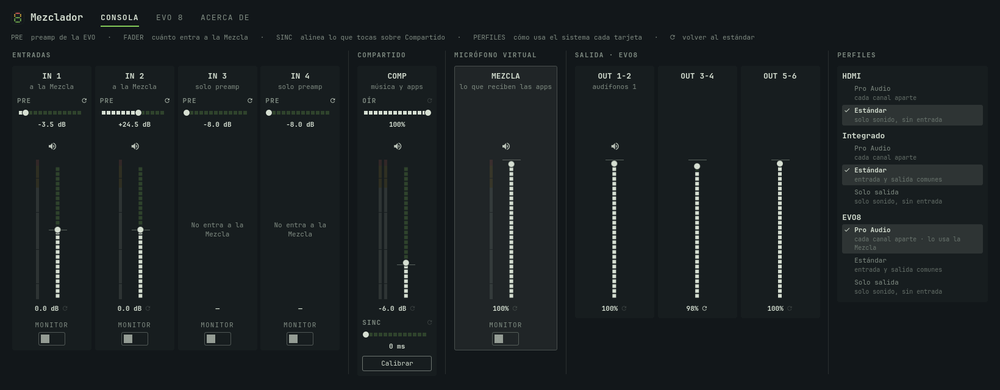

<p align="center"></p>

# evo8-linux

<p>
<a href="https://pypi.org/project/evo8-linux/"></a>
<a href="https://github.com/wh01s17/evo8-linux/actions/workflows/ci.yml"></a>

</p>

Control del **Audient EVO 8** en Linux: una ventana tipo consola y un CLI
para la interfaz y para el audio del sistema.

Audient solo publica **EVO Control** para Windows y macOS. En Linux la EVO 8
funciona como interfaz de audio estándar, pero el kernel no expone su mezcla de
monitoreo interna ni el ruteo del loop-back. evo8-linux los recupera hablando
con la interfaz por USB con el mismo protocolo que usa EVO Control. Además
incluye un mezclador para PipeWire y, si lo necesitas, un micrófono virtual que
junta tus entradas con el audio de otras apps.



## Qué hace

**El hardware de la EVO 8, como en EVO Control**

- **Mezcla de monitoreo interna**: lo que oyes directo en los audífonos, sin
  pasar por el PC y sin latencia. Es la matriz de 10 entradas (4 analógicas y
  6 del PC) × 4 salidas, con fader, paneo y silencio, y atajos como «Como de
  fábrica» u «Oír entradas 1 y 2».
- **Loop-back**: qué llega a los canales de captura 5-6. Puede ser el par de
  fábrica, todo lo que suena en el PC (salidas 1-2), las salidas 3-4 o las
  entradas 1-2 / 3-4.
- **Entradas**: ganancia del preamp en dB, phantom 48 V y silencio.
- **Al conectarla**: la EVO olvida esos ajustes cuando se apaga. Un servicio
  los restaura al conectarla. El phantom nunca se enciende solo.

**Un mezclador para el audio del sistema**

- Volumen, silencio y medidores de las entradas, las apps y la salida
  seleccionada, por canal.
- **Monitor**: escuchar una entrada, o todo, por la salida seleccionada, con
  latencia baja.
- **Perfiles de tarjeta**: elegir cómo usa el sistema cada tarjeta de sonido,
  con lo que hace cada opción.

**Un micrófono virtual, si lo necesitas**

- **Mezcla**: un micrófono que suma las entradas 1-2 de la EVO y una salida
  virtual, **Compartido**. Lo que mandes a Compartido (música, un metrónomo,
  un backing track) lo escuchas tú y también sale por la Mezcla. Cualquier app
  puede usarla como micrófono: OBS, un DAW, Discord o el navegador.
- **Ganancia en vivo** por canal, y apps que se mandan a Compartido de a una.
- **Sincronía**: quien toca sobre la música la oye con retraso, y su
  instrumento llega con otro. *Calibrar* mide ese desfase mientras tocas sobre
  un click y lo compensa retrasando la música solo hacia la Mezcla.
- Los navegadores no pueden bajar el volumen de la Mezcla por su cuenta.

## Instalación

Solo para la **Audient EVO 8** (no la EVO 4 ni la EVO 16). El control por USB
se probó con el firmware 1.4c.

### Arch Linux

```sh
git clone https://github.com/wh01s17/evo8-linux
cd evo8-linux/packaging/arch
makepkg -si
```

Instala todo en el sistema y trae las dependencias, incluida la fuente de los
íconos. Después, desconecta y vuelve a conectar la EVO una vez.

### Otras distribuciones (pipx)

```sh
pipx install "evo8-linux[gui,usb]"
evoctl setup
```

pip solo instala Python. `evoctl setup` copia a tu usuario la config de
PipeWire, el servicio que restaura los ajustes y la entrada del menú, y te da
el comando `sudo` exacto para la regla udev (control por USB sin root). También
avisa si falta algo del sistema: PipeWire, WirePlumber, `pactl`, `amixer` o la
fuente *JetBrainsMono Nerd Font*. Después de `pipx upgrade`, vuelve a correr
`evoctl setup`. Para desinstalar: `evoctl setup --remove` y
`pipx uninstall evo8-linux`.

### Desde el código

Requisitos: PipeWire + WirePlumber, `pactl`, `amixer`, Python ≥ 3.11,
`python-pyusb`, `pyside6`, `qt6-svg` y *JetBrainsMono Nerd Font*
(`ttf-jetbrains-mono-nerd`).

```sh
git clone https://github.com/wh01s17/evo8-linux
cd evo8-linux
make install      # evoctl y evo8-mixer en ~/.local/bin, apuntando a esta carpeta
sudo make udev    # control por USB sin root
```

No mezcles esta instalación con el paquete: los lanzadores de
`~/.local/bin` tendrían prioridad. `make uninstall` los quita.

### Primeros pasos

1. Reinicia PipeWire para cargar la Mezcla (corta el audio un momento):
   `systemctl --user restart pipewire pipewire-pulse wireplumber`
2. Pon la EVO 8 en el perfil **Pro Audio**, desde la pestaña CONSOLA (columna
   PERFILES) o con
   `evoctl profiles set alsa_card.usb-Audient_EVO8-00 pro-audio`.
3. Para usar el micrófono virtual, elige **Mezcla** como micrófono en la app.
   Si la app tiene supresión de ruido o control automático de ganancia,
   desactívalos: alteran la música que mandas por Compartido.

## Uso

### La ventana

`evo8-mixer`, o *Mezclador EVO 8* en el menú de aplicaciones.

- **CONSOLA**: una tira por canal, en el orden en que viaja el sonido:
  entradas, Compartido, las apps, la Mezcla y la salida. Cada una tiene
  preamp, fader, medidores, silencio, monitor y 󰑐 para volver al valor
  estándar. Al final están los perfiles de cada tarjeta, con lo que hace cada
  uno.
- **EVO 8**: la mezcla de monitoreo interna y el loop-back. Los cambios
  quedan en espera hasta que pulsas *Aplicar a la EVO*, porque cada envío por
  USB corta el audio un instante (ver [Cómo funciona](#cómo-funciona)).
- **ACERCA DE**: versión, firmware de la EVO, cómo está instalado y un botón
  que copia esos datos para reportar un problema.


`evo8-mixer --evo` abre directo en la pestaña EVO 8. Hay una sola ventana:
volver a lanzarla la trae al frente.

### La línea de comandos

```sh
# Micrófono virtual
evoctl mix get                    # ganancias: [entrada 1, entrada 2, Compartido L, R]
evoctl mix set 1 0.8              # entrada 1 al 80 % (lineal, 0..4)
evoctl share list                 # apps que están en Compartido
evoctl share on <node-id>         # mandar una app a Compartido
evoctl delay set 40               # retrasar Compartido 40 ms hacia la Mezcla
evoctl calibrate --apply          # medir el desfase tocando sobre un click
evoctl apply                      # restaurar lo guardado tras reiniciar PipeWire

# Monitor
evoctl monitor toggle             # escuchar la Mezcla completa
evoctl monitor input 1 on         # escuchar solo la entrada 1

# Hardware de la EVO (cada comando corta el audio ~0,1 s)
evoctl preamp set 2 24.5          # preamp de la entrada 2 en dB
evoctl hw input phantom 2 on      # 48 V en la entrada 2
evoctl hw input mute 3 on         # silenciar la entrada 3 en la EVO
evoctl hw loopback set pc12       # loop-back = lo que suena por las salidas 1-2
evoctl hw mix get                 # mezcla interna (dB)
evoctl hw mix set 1 1 -6          # entrada 1 → salida 1 a -6 dB
evoctl hw mix set 5 3 off         # PC 1 → salida 3 apagado

evoctl --help                     # todos los comandos
```

La salida es JSON o un valor por línea, para usarla en scripts o en una barra
de escritorio.

## Cómo funciona


El proyecto mueve dos cosas distintas:

- **El audio en el PC** (verde) lo hace PipeWire. Una config instalada por
  evo8-linux crea **Compartido** (una salida virtual), **mezcla.suma** (un
  *filter-chain* que retrasa Compartido y aplica una ganancia por canal) y la
  **Mezcla** (el micrófono virtual). La ventana y `evoctl` cambian esos valores
  al instante, sin cortes.
- **El hardware de la EVO** (ámbar) no pasa por PipeWire. EVO Control usa
  peticiones USB estándar de audio (UAC2) que el kernel no expone. Linux no
  deja enviarlas mientras el driver de audio tiene la interfaz, así que
  evo8-linux suelta el driver, envía y lo devuelve. El audio se corta ~0,1 s,
  y por eso la ventana agrupa los cambios y espera a que pulses *Aplicar a la
  EVO*.

El protocolo, las peticiones que usa EVO Control y lo verificado en el
dispositivo están en
[`docs/protocolo-usb.md`](https://github.com/wh01s17/evo8-linux/blob/main/docs/protocolo-usb.md).

## El repositorio

| Ruta | Qué hay |
|---|---|
| [`src/evo8/`](https://github.com/wh01s17/evo8-linux/tree/main/src/evo8) | La librería y `evoctl`: PipeWire (`pw.py`, `mix.py`, `monitor.py`, `apps.py`), preamps (`alsa.py`), USB (`usb.py`, `hw.py`), sincronía (`calibrate.py`) y `evoctl setup` (`user_setup.py`) |
| [`src/evo8/gui/`](https://github.com/wh01s17/evo8-linux/tree/main/src/evo8/gui) | La ventana: PySide6 y QML |
| [`src/evo8/data/`](https://github.com/wh01s17/evo8-linux/tree/main/src/evo8/data) | Config de PipeWire, regla udev, servicio, entrada del menú e ícono |
| [`packaging/arch/`](https://github.com/wh01s17/evo8-linux/tree/main/packaging/arch) | El PKGBUILD |
| [`docs/protocolo-usb.md`](https://github.com/wh01s17/evo8-linux/blob/main/docs/protocolo-usb.md) | El protocolo USB de la EVO 8 |
| [`plan.md`](https://github.com/wh01s17/evo8-linux/blob/main/plan.md) | Arquitectura, estado y próximos pasos |
| [`CHANGELOG.md`](https://github.com/wh01s17/evo8-linux/blob/main/CHANGELOG.md) | Cambios de cada versión |
| [`PUBLISH.md`](https://github.com/wh01s17/evo8-linux/blob/main/PUBLISH.md) | Cómo publicar una versión |

Los tests corren con `make test`, sin necesidad de tener la EVO conectada.

## Advertencia

Proyecto independiente, sin relación con Audient. EVO y EVO Control son
marcas de Audient. El control por USB se basa en ingeniería inversa para
interoperabilidad y no incluye código ni binarios de Audient. Se probó en una
EVO 8 con firmware 1.4c. Úsalo bajo tu responsabilidad: si la interfaz deja de
responder, desconéctala y vuelve a conectarla.

## Licencia

MIT
